<p align="center">
  
</p>

<h1 align="center">Keystone</h1>

<p align="center">
  <b>Your OpenWrt router, on your phone.</b><br>
  With extra screens for 5G routers and the Arcadyan AW1000.
</p>

<p align="center">
  <a href="https://github.com/Perz3us/Keystone/releases/latest"></a>
  <a href="https://github.com/Perz3us/Keystone/releases"></a>
  <a href="https://github.com/Perz3us/Keystone/stargazers"></a>
  <a href="https://github.com/Perz3us/Keystone/actions/workflows/ci.yml"></a>
  <br>
  <a href="#what-you-need"></a>
  <a href="#what-you-need"></a>
  <a href="LICENSE"></a>
</p>

<p align="center">
  <a href="https://github.com/Perz3us/Keystone/releases/latest"></a>
</p>

<p align="center">
  Keystone isn't on the Play Store. Get it only from the
  <a href="https://github.com/Perz3us/Keystone/releases/latest">releases page</a> here.
</p>

<p align="center">
  <a href="#features">Features</a> ·
  <a href="#screenshots">Screenshots</a> ·
  <a href="#install">Install</a> ·
  <a href="#add-ons">Add-ons</a> ·
  <a href="#troubleshooting">Troubleshooting</a> ·
  <a href="CHANGELOG.md">Changelog</a>
</p>

<p align="center">
  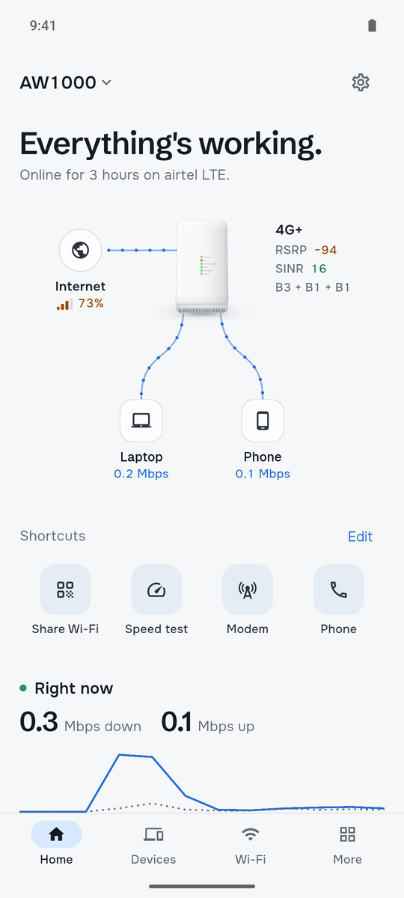
  &nbsp;&nbsp;&nbsp;
  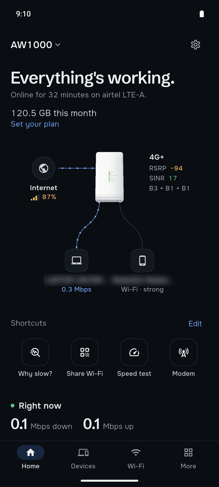
</p>

LuCI works, but on a phone it's a lot of pinching and zooming. Keystone shows what you
actually check day to day: is the internet up, who's connected, how fast it is, and the Wi-Fi.
It reads like a consumer router app, without hiding what OpenWrt can do.

It talks to the router the same way LuCI does, over ubus and rpcd, so there's nothing to
install on the router to get started. There's no account, no ads and no tracking, and your
router passwords stay in the phone's secure storage.

## Features

| Screen | What you can do |
| --- | --- |
| **Home** | Whether everything's working, in one sentence, plus live speed and your own shortcuts |
| **Devices** | Names, vendors, signal, fixed addresses, speed limits, pausing and blocking |
| **Wi-Fi** | Name, password, bands, guest Wi-Fi and a QR code to share it |
| **Parental controls** | People, bedtimes, daily limits and site filters |
| **Firewall** | Rules and port forwards |
| **DHCP and DNS** | Leases, fixed addresses and DNS settings |
| **Diagnostics** | Finds connection problems step by step, plus ping, traceroute and DNS speed |
| **Packages** | Search, install and remove with `opkg` or `apk` |
| **Router care** | Logs, services, scheduled tasks, backups and firmware upgrades |
| **SSH terminal** | For everything else, with saved commands |

<details>
<summary><b>5G and LTE routers</b></summary>
<br>

With the 5G Modem app or QModem on the router. What shows depends on your modem and firmware.

- Signal, towers, bands and SIM details
- Lock bands or a cell, and tap a nearby cell to use it
- Preferred towers, with [`auto-pci-cell`](https://github.com/Perz3us/PCI-Cell-Lock)
- Signal bars and readings on Home, where you choose what shows
- Network mode, restart and SIM slot
- APN, roaming, speed options, and Check and fix, which tries to get the internet back step by step
- Aim the antenna: live signal with a tone that rises as it improves
- History: signal, line ping and data over time

</details>

<details>
<summary><b>AW1000 phone port</b></summary>
<br>

Needs the [`fxs`](https://github.com/Perz3us/openwrt-aw1000-phone),
[`modem-sip`](https://github.com/Perz3us/openwrt-modem-sip) and
[`aw1000-voice`](https://github.com/Perz3us/noobwrt-aw1000-voice) packages.

- The RJ11 line, call history and recordings
- Texts and balance codes
- SIP phones, with a QR code to set one up
- Blocked numbers, quiet hours and call forwarding
- Missed-call alerts

</details>

<details>
<summary><b>When they're installed</b></summary>
<br>

AdGuard Home, Passwall and Passwall2, SQM, per-device traffic, WireGuard and Tailscale status,
and Wake-on-LAN.

</details>

## Only what your router has

When you sign in, Keystone asks the router which services it has and only shows the screens
that will work. Install `luci-app-sqm` and SQM shows up the next time you pull to refresh.
Remove it and it goes away.

Keystone also asks before anything that would cut off your own phone, like blocking it or
turning off the band it's on.

## Screenshots

<table>
  <tr>
    <td width="25%" align="center"><b>Sign in</b><br><br>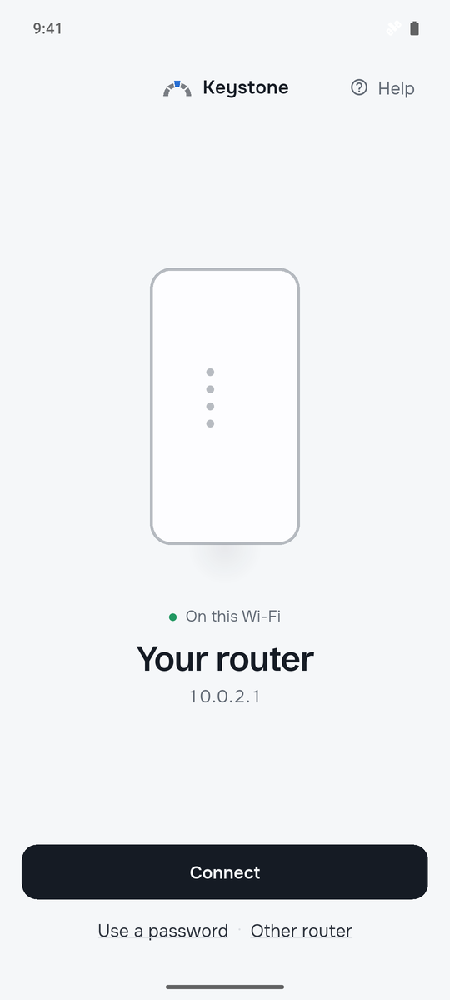</td>
    <td width="25%" align="center"><b>Devices</b><br><br>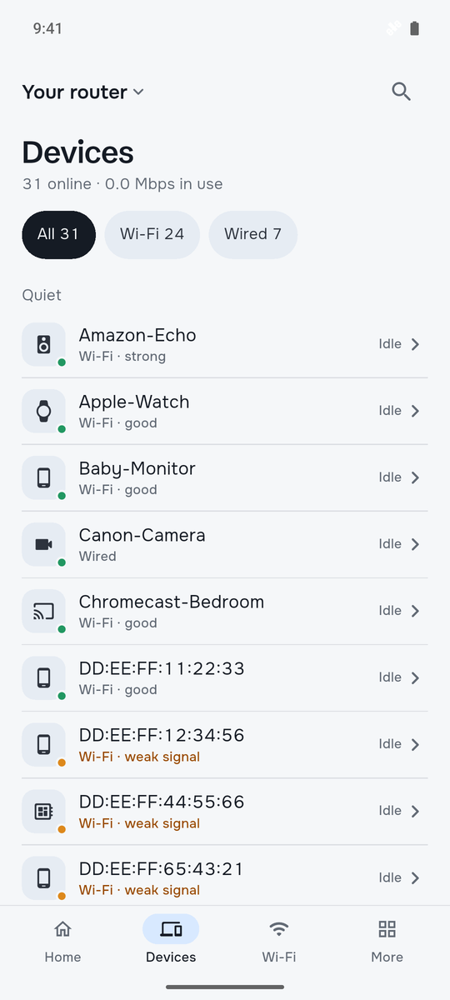</td>
    <td width="25%" align="center"><b>Wi-Fi</b><br><br>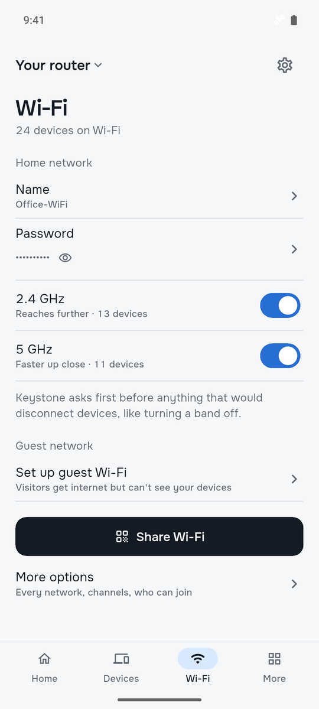</td>
    <td width="25%" align="center"><b>Share Wi-Fi</b><br><br>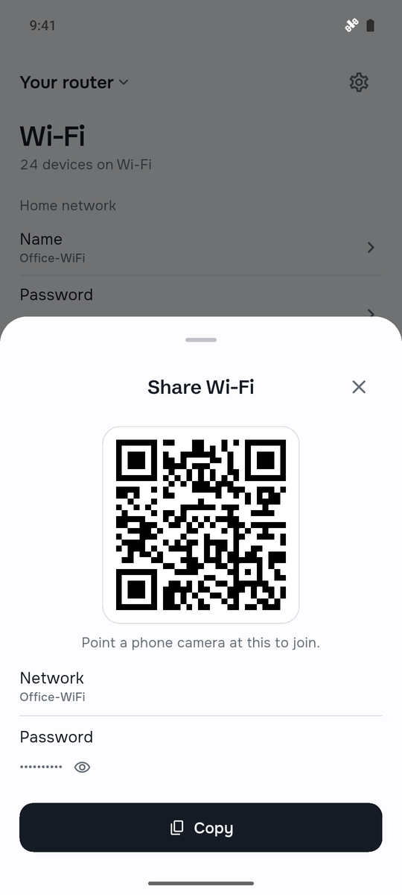</td>
  </tr>
  <tr>
    <td width="25%" align="center"><b>Modem</b><br><br>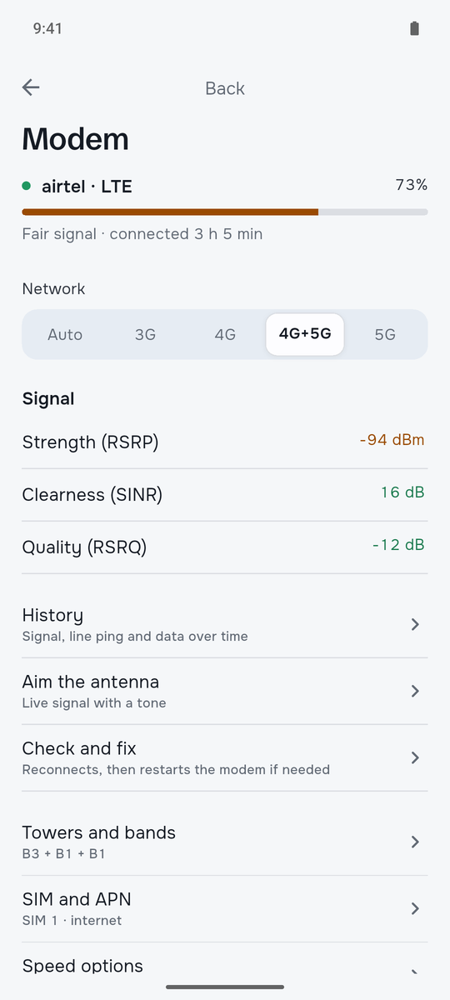</td>
    <td width="25%" align="center"><b>History</b><br><br>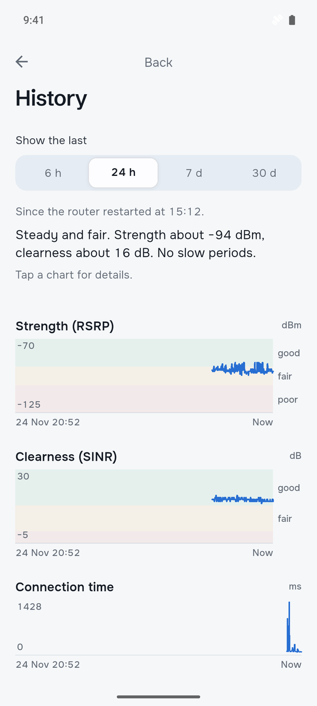</td>
    <td width="25%" align="center"><b>Aim the antenna</b><br><br>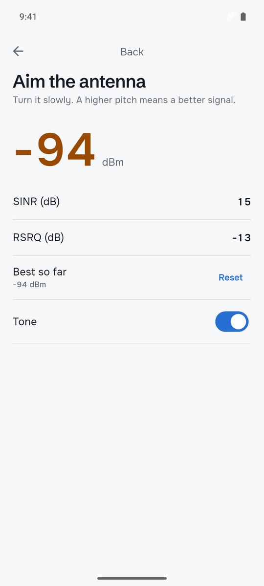</td>
    <td width="25%" align="center"><b>Troubleshoot</b><br><br>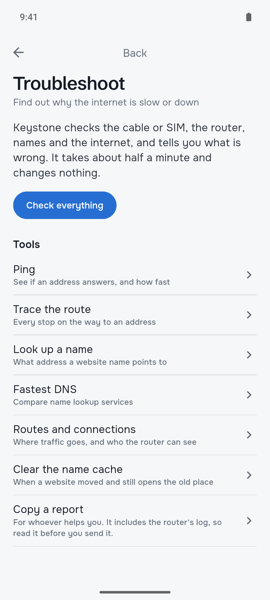</td>
  </tr>
</table>

<details>
<summary><b>More screenshots</b></summary>
<br>

<table>
  <tr>
    <td width="25%" align="center"><b>More</b><br><br>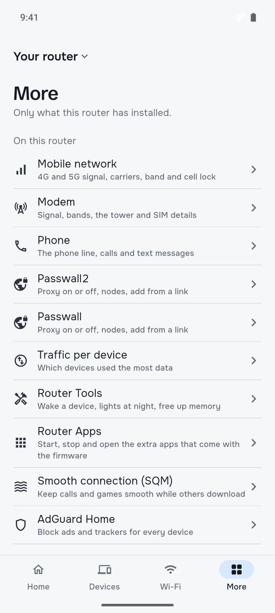</td>
    <td width="25%" align="center"><b>Firewall</b><br><br>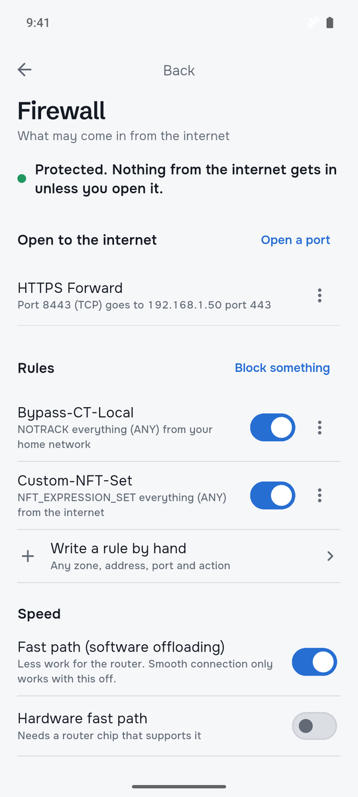</td>
    <td width="25%" align="center"><b>VPN</b><br><br>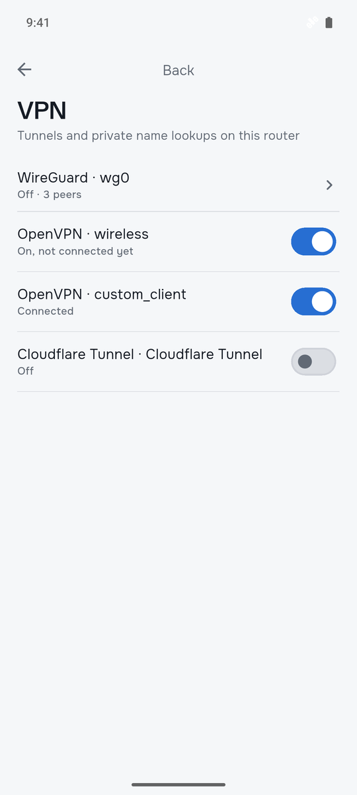</td>
    <td width="25%" align="center"><b>Backup and firmware</b><br><br>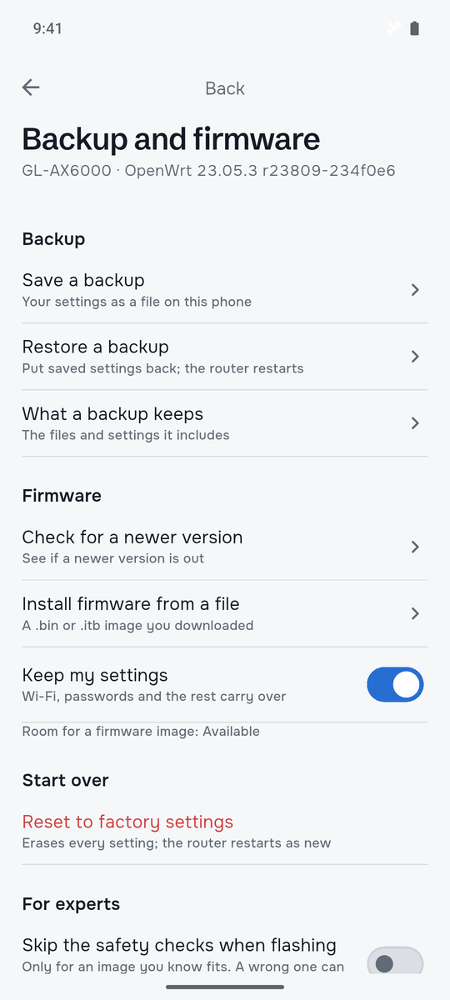</td>
  </tr>
  <tr>
    <td width="25%" align="center"><b>Devices, dark</b><br><br>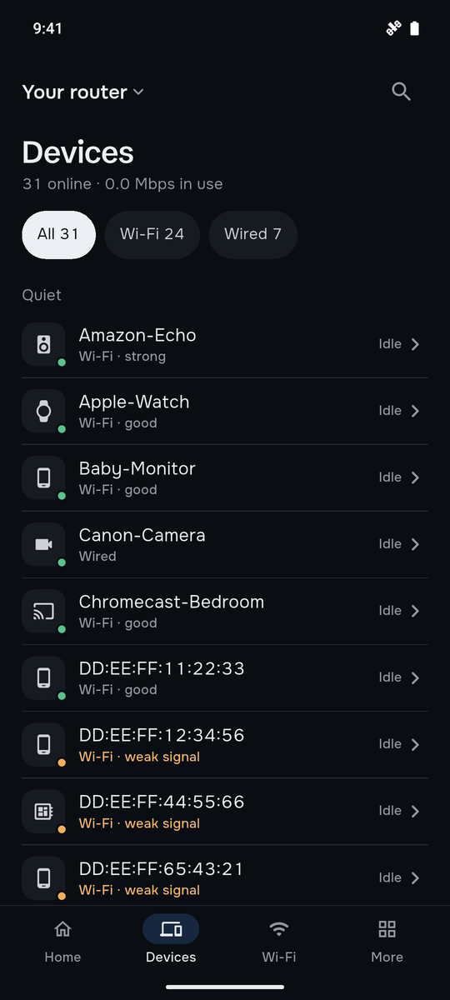</td>
    <td width="25%" align="center"><b>Add-ons</b><br><br>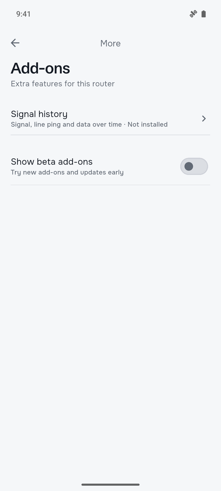</td>
  </tr>
</table>

</details>

Home, Troubleshoot and the modem screens are from a real AW1000, with device names changed. The
rest are from the built-in demo.

## What you need

- A router with LuCI, on OpenWrt, ImmortalWrt or
  [NoobWRT](https://github.com/nooblk-98/noobwrt-arcadyan-aw1k). OpenWrt 25.12 is the main
  target. Older versions work too, without the screens they can't support
- An Android phone, 8.0 or newer

Stock vendor firmware isn't supported, because it doesn't have the LuCI login Keystone uses.

## Install

1. Download one APK from the [latest release](https://github.com/Perz3us/Keystone/releases/latest):

   | File ends with | For |
   | --- | --- |
   | `arm64-v8a.apk` | Nearly every phone |
   | `armeabi-v7a.apk` | Older 32-bit phones |
   | `x86_64.apk` | Emulators and some Chromebooks |
   | `universal.apk` | Any of these, if you're not sure. It's about three times the size |

2. Install it, and connect to your router's Wi-Fi. Android may ask you to allow installs from
   your browser the first time.
3. Open Keystone and tap Connect. If you set a root password, it asks for it.

They're all the same app with the same signature, so you can switch from one to another later
and keep your settings.

### Updating

Keystone checks GitHub once a day. When a new version is out, **More → Check for updates**
shows it. Tap **Download and install**: Keystone picks the right APK for your phone, checks it
against the checksum on the release, and Android asks you to install it. The first time, Android
asks you to allow installs from Keystone. Your routers and settings stay.

Only the APKs from GitHub update themselves. Apps like [Obtainium](https://github.com/ImranR98/Obtainium)
work too.

To look around without a router, hold the Keystone logo on the sign-in screen for five
seconds. That opens a demo with made-up devices.

## Add-ons

Some features need a small helper on the router. These live in their own repo,
[**keystone-packages**](https://github.com/Perz3us/keystone-packages), one package per feature.
They're optional, and Keystone can install, update and remove them for you under
**More > Add-ons**.

| Package | What it adds |
| --- | --- |
| [`keystone-history`](https://github.com/Perz3us/keystone-packages#keystone-history) | Records signal, ping and data use on the router, so History has graphs even while the app is closed |

Both `apk` and `opkg` routers are supported. To install a package by hand, download it from the
[keystone-packages releases](https://github.com/Perz3us/keystone-packages/releases).

## Troubleshooting

- **Can't connect.** Open the router's address in your phone's browser. If LuCI doesn't load
  there either, check the address, the Wi-Fi and any VPN on the phone.
- **Can't sign in.** Use the same name and password as LuCI, usually `root`.
- **Screens are empty or missing.** The router may be missing LuCI's modules. Install them,
  restart rpcd, then pull to refresh:

  ```sh
  # OpenWrt 25.12 and newer
  apk update && apk add rpcd-mod-luci rpcd-mod-iwinfo

  # Older versions
  opkg update && opkg install rpcd-mod-luci rpcd-mod-iwinfo

  /etc/init.d/rpcd restart
  ```

- **Still stuck?** [Open an issue](https://github.com/Perz3us/Keystone/issues) with the router
  model and firmware version.

## Building

You need Flutter 3.47 and the Android SDK.

```
flutter pub get
flutter build apk --release --flavor community --split-per-abi
```

The APKs end up in `build/app/outputs/flutter-apk/`. To sign them with your own key, copy
`android/key.properties.example` to `android/key.properties` and fill it in. To run it on an
emulator or phone:

```
flutter run --flavor community
```

Tests:

```
flutter test
```

## Contributing

Bug reports, ideas and pull requests are welcome. Before a pull request, run `dart format .`,
`flutter analyze` and `flutter test`, because GitHub checks all three.

If Keystone is useful to you, you can [sponsor me on GitHub](https://github.com/sponsors/Perz3us).

## Credits

Keystone grew out of two other open source apps. Thanks to both authors.

| Project | Author | Role |
| --- | --- | --- |
| [LuCI Mobile](https://github.com/cogwheel0/luci-mobile) | [cogwheel0](https://github.com/cogwheel0) | The original app |
| [YALA](https://github.com/nightcodex7/yala) | [nightcodex7](https://github.com/nightcodex7) | The version Keystone started from |

## License

Keystone is free software under the [GNU General Public License v3.0](LICENSE) or any later
version. You can use, change and share it. If you share a changed version, share its source
under the same license. It comes with no warranty.

<sub>
Copyright © 2025-2026 cogwheel0 (original work)<br>
Copyright © 2026 @nightcodex7 (modifications)<br>
Copyright © 2026 Perz3us (modifications)
</sub>

<br>

<sub>Keystone isn't affiliated with OpenWrt, Arcadyan, Telstra, Quectel or the projects above.</sub>
